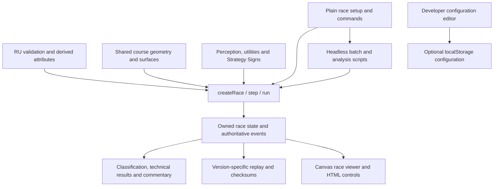

# Blood and Thunder — Technical Architecture Audit

## A. Executive summary

**Recommendation: proceed to a small management foundation after approving persistence and championship policies; do not rewrite the racing engine.** The repository contains a tested racing prototype and track catalogue, not a partially implemented stable-management game. Its explicit headless inputs, copied RU components, deterministic replay and structured results provide useful integration points. Career state, persistent component identities, ownership, championships, finances, training, markets and Owner Legacy are absent. Reliable save commits and exactly-once race/settlement application must precede the playable career loop.

Audited source: **`171ea008cebadcb183ba137c7d6f1bf887897aa0`**, branch `work`, simulation **`0.6.0-tracks`**, package **`0.6.0`**. The working tree was clean at entry. This is a source inspection and fresh verification by the same assistant, not an independent external certification. No management implementation, production-source change, balance change, dependency change, commit or push was performed.

**Fresh evidence:** 212 automated tests passed; the standalone rebuild is byte-identical; 23 retained browser checks and 10 track-browser check groups passed functionally; two reference races reconstructed exactly and 16 additional seeded batch races Ended without errors/stalls. Direct `file://` navigation was attempted and administrator-blocked. Browser checks used an explicitly labelled local HTTP diagnostic origin, then disabled networking. They do not establish local-file operation or persistence. Previous owner-confirmed offline operation belongs to an earlier artifact.

The assumed TypeScript/Phaser architecture is **not present**. Actual runtime is vanilla JavaScript ES modules during development, HTML/CSS, Canvas 2D and an inline IIFE in the exported HTML. This agrees with establishment documents `00`/`01`/`08`, which explicitly supersede older TypeScript/Phaser directions. The current task's management rules supply new design requirements; older vision documents leaving championship/economy questions open do not override them. No framework migration is needed or recommended.

Evidence vocabulary throughout:

- **Verified:** inspected implementation or executed behavior; paths/functions and evidence are provided.
- **Historical:** previously recorded measurements reviewed here, not rerun in full.
- **Inference:** a technical consequence or risk suggested by the inspected design, without proof of an actual failure.
- **Recommendation:** proposed future work; none of the proposed modules/interfaces below exists yet.
- **Unverified:** platform, durability, balance or design behavior not established by this audit.

Companion: [implementation readiness matrix](Blood-and-Thunder-Implementation-Readiness.md). Raw logs, reference/replay outputs and interface probes: [audit evidence](architecture-audit/evidence/).

## B. Actual architecture

### Repository, tooling and dependencies

| Area | Verified implementation |
|---|---|
| Languages | JavaScript `.js`/`.mjs`, HTML/CSS, JSON; Python for some historical analysis/report scripts. No TypeScript application files or tsconfig found. |
| Runtime frameworks | None. Canvas 2D draws races; ordinary HTML/CSS builds menus, results and developer tools. No Phaser/React dependency. |
| Node package | `package.json`: ESM, two exact development dependencies: `esbuild@0.28.2`, `playwright-core@1.65.1`; no runtime npm dependencies. The third installed package is esbuild's matching Linux platform binding. Other-OS optional bindings shown as unmet by `npm ls --all` are expected, not missing runtime requirements. |
| Entry/build | `src/ui/app.js` and `src/ui/index.html`; `scripts/build.mjs` bundles an ES2020 browser IIFE into one inline script and emits two identical HTML filenames. No runtime server or fetch-based data loading. |
| Tests | Eleven `*.test.js` files under `tests/`, shared `tests/fixtures.js`, Node built-in test/assert. Browser tests use installed Chromium through playwright-core; browser installation is not supplied by that package. |
| Commands | `test`, `build`, `test:browser`, `check`, `reference`. No typecheck or lint command/configuration found. No repository CI workflow found in the audited file inventory. |
| Utilities | `src/dev/` component/configuration overrides and yielding race batches; `scripts/` reference, investigation, matched-comparison and track-validation tools. Python plotting utilities use NumPy/Matplotlib outside the npm lockfile; they are optional development analysis tools and were not exercised here. |
| Documents/evidence | Numbered establishment documents, current implementation/development/assumptions/checklist files, milestone reports, historical audits, Phase 2 studies and later implementation reports. Existing `docs/` is about 184 MiB, mostly historical evidence; it is not embedded in the 210,295-byte HTML. |

No unnecessary runtime dependency was identified. The two HTML outputs are intentional aliases, not two engines. The old four course presets and newer catalogue coexist for configuration compatibility, not as separate movement implementations. Study-specific workers/report scripts contain repeated orchestration; consolidate only when a new common career evaluator needs it, preserving historical reproduction. Adding a framework or replacing the build would increase scope without solving a demonstrated problem.

### Source responsibilities and data flow

- `src/model/ru.js`: `defaultRU`, `validateRU`, `derive`; component attribute/condition payloads and derived performance.
- `src/config/config.js`: current simulation version, defaults, numeric ranges and normalized coefficient validation.
- `src/track/`: original oval adapter, connected straight/arc geometry, fixed catalogue, surface profiles, seeded Rally authoring and sampled corridor diagnostics.
- `src/core/determinism.js`: keyed deterministic draws, canonical serialization, diagnostic checksums. No global random stream shared with the UI.
- `src/sim/race.js`: mutable engine-owned state; constructor/validation, chronological within-tick resolution, occupancy, crossings, classification, capture, integrity/stall administration. It is 1,138 lines; its size is a maintenance concern, not evidence that it needs replacement.
- `src/sim/kinematics.js`, `environment.js`, `consequences.js`, `incidents.js`: movement/braking, weather/fatigue/strain/wear, attacks/impacts/component condition/control/wrecks, deterministic hazards.
- `src/ai/`: personality, filtered perception, utilities, contextual combat valuation, intended/effective/physical outcome telemetry and sign compliance.
- `src/events/events.js`: copied event effects with ordered IDs and tick/subtick time. IDs are local to a race.
- `src/reporting/`: `classification`-based results, technical statistics and event-derived radio commentary.
- `src/replay/replay.js`: replay reconstruction and first-divergence verification; requires matching simulation version.
- `src/dev/`: developer configuration persistence and imports, supported paused overrides, asynchronous/cancellable batches.
- `src/ui/app.js` (719 lines), `workbench.js` (370): singleton race view, rendering, transport, setup, inspector, replay and developer tools. UI clock and wall time do not decide authoritative race outcomes.

The engine accepts explicit plain data, validates it and clones entrant RU components. Defaults exist if inputs are omitted; the proposed management adapter must prohibit unintended fallback/default assets. `createRace` returns a mutable state, `step` mutates it, and `run` repeatedly calls the same step path. The headless engine does not require a browser, Phaser, storage or a DOM. Tests explicitly guard this separation. The UI has a singleton current race and developer APIs on `window.BNT`; that is presentation state, not a career store.

## C. Existing feature inventory

Statuses describe usable code, not design-document promises. **Implemented/tested** means covered by current executed tests within their bounds, not universal completion or final acceptance.

| System | Current status | Evidence | Gap | Risk for management integration |
|---|---|---|---|---|
| Headless race setup/run | Implemented/tested | `sim/race.js:createRace,step,run`; foundation/prototype tests | Need career-side strict setup contract and execution owner | LOW |
| Driver/beast/chariot attribute formulas | Implemented/tested | `model/ru.js:validateRU,derive`; five driver/six beast attributes | Career metadata, identity, ownership and progression absent | MODERATE |
| Equipment | Partial | `ru.js`: only `mass`, `combat` effects | No item IDs, slots, inventory, durability or item catalogue | MODERATE |
| Optional passenger | Missing | No passenger in model/schema/source inventory | Requires approved effect semantics and adapter/model extension if gameplay effects are wanted | MODERATE; defer |
| AI/personality/perception | Implemented/tested | `ai/driver.js`, `combat-value.js`, refinement tests | No learned-technique hook or career AI policy; no need to change current behavior | LOW for reuse |
| Speed/braking/corner risk | Implemented/tested | `kinematics.js`, `race.js`, foundation/courses tests | No management dependency | LOW |
| Lane/tile occupancy and simultaneous contacts | Implemented/tested | `race.js:laneChanges`, chronological solver, `assertState` | Four physical lanes on generic courses; no variable-lane merges | LOW |
| Pure/Combat legality | Implemented/tested | `consequences.js:eligibleCombat,resolveAttacks`, AI and tests | Championship must select a permitted mode | LOW |
| Damage/control/wrecks | Implemented/tested within a race | `consequences.js:flushImpacts,updateControl,retire` | No permanent injury, death, recovery-duration or destroyed-asset rules | HIGH consequence-policy dependency |
| Fatigue/driver strain/chariot wear | Implemented/tested | `environment.js:integrateCondition` | Between-race carry/recovery policy absent | MODERATE |
| Historical fatigue at finish | Implemented/tested | `race.js:lockFinish`; corrective B03 tests | Only fatigue/time are historical finish snapshots, not every component's finish condition | MODERATE |
| Weather/surfaces/incidents | Implemented/tested | `environment.js`, `incidents.js`, terrain/surface profiles | Static weather; no need for new weather systems | LOW |
| Finish times/ties/standings | Implemented/tested | `race.js:crossing,classification`; common line/interpolation tests | Championship scoring/tie rules absent | MODERATE |
| DNF/retirement | Implemented/tested | `retire`, `endIfDone`, blockage regressions | Retirement is not a career asset-deletion rule | MODERATE |
| DNS | Partial | Classification/rendering recognize DNS; foundation test manually sets it | Constructor starts all entrants Racing; no public DNS entry command/controller | MODERATE if championship needs DNS |
| Disqualification | Missing | `applyCommands` only lane/pace/sign/attack/override; probe rejects `disqualify` | No DQ adjudication/status/penalty system | MODERATE; do not invent one |
| Finished-unit exit/blocked clearance | Implemented/tested | `endIfDone`, exit/wreck tests | Can legitimately return Stalled after all classifications lock; consumer must distinguish this from invalid/incomplete results | HIGH if ignored |
| Three ovals | Implemented/tested | `track/catalog.js:ovalPresets`; expansion tests | Constant lane count; dimensions/laps configurable | LOW |
| Twelve irregular circuits | Implemented/tested | `catalog.js:circuitCatalog` C01–C12; uniqueness, both turns, footprint tests | Custom changes still require validation | LOW |
| Procedural short/medium/long Rally | Implemented/tested | `rally-generator.js:generateRally`; 100 seeds/category in fresh suite | Bounded chunks/retries and identified straight fallback; not arbitrary terrain generation | LOW/MODERATE |
| Deterministic route seeds/terrain | Implemented/tested | Separate keyed generator namespace; five existing terrains; recipe round-trip tests | Store full route, not seed alone, across future generator versions | LOW |
| Track validation | Implemented/tested, bounded | `course.js:normalizeCourse,compileCourse`; `validation.js:validateFootprint` | Nonlocal overlap validation is sampled and a separate call; custom `createRace` compilation is not an exhaustive footprint proof | MODERATE for custom offers |
| Lap/terminal finish and Rally checkpoints | Implemented/tested | courses/expansion regressions, three full generated races in suite | Must retain topology and saved checkpoint distances | LOW |
| Six queued Strategy Signs | Implemented/tested | `ai/signs.js`, telemetry tests; Rally and closed activation | Career equipment/progression must not silently change uses or effects | LOW |
| Track selector/previews/follow/minimap | Implemented/tested | Fresh 10-group track-browser campaign; actual geometry drawn | Long-route/per-browser performance not exhaustively benchmarked | LOW/MODERATE |
| Replay and structured exports | Implemented/tested | `capture`, `results`, `verifyReplay`; fresh reference/browser checks | Race-local IDs, version-specific replay, some result aliases; no career receipt | MODERATE |
| Config save/load/import/export | Implemented/tested for scenarios | `dev/configuration.js`; storage error/corruption tests | Single test-configuration key, explicit manual saves, no career autosave/recovery | HIGH if mistaken for career persistence |
| Stable roster/asset registry | Missing | No `career`, `stable`, ownership or entity registry module | Need independent driver/beast/chariot/item IDs and references | HIGH prerequisite |
| Championship/run controller | Missing | No championship implementation; race batch simply repeats races | State machine, six-stage template, fixed entry, offers, standings/withdrawal | HIGH prerequisite |
| Treasury/run budget/ledger/settlement | Missing | No finance/transaction implementation | Separate accounts, receipts, atomic commit, obligations and liquidation | HIGH prerequisite |
| Staff/employment/facilities/property | Missing | Only design references | Contracts, qualifications, capacity, plots, upkeep, construction/relocation | MODERATE/HIGH; mostly defer |
| XP/techniques/traits/potential/training | Missing | Current numeric attributes/personality only | Persistent advancement schema/rules and project lifecycle | MODERATE/HIGH; defer advanced parts |
| Markets/recruitment | Missing | No offer/purchase/refresh/disclosure code | Saved generated offers, ownership transfer and economy transactions | MODERATE |
| Career failure/Controlled Liquidation | Missing | Race retirement is unrelated to stable viability | Restricted recovery commands, solvency, terminal career state | HIGH |
| Owner Legacy | Missing | No profile/unlock/legacy storage | Profile record, exactly-once career closure, later perks | MODERATE |

The previous track task **does exist**. This audit reran its automated validity/determinism/checkpoint regressions and its browser selection/generation/parity campaign. Its historical 60-race panel and 36 replay files were reviewed, not all re-executed. No track expansion prerequisite blocks management. Championship offers can store the existing normalized track definitions; neither economy nor championships needs to be placed in the geometry module.

## D. Design-to-code gap analysis

### Racing boundary: what can be reused, what needs an adapter

| Question | Finding |
|---|---|
| Complete inputs or globals? | Explicit setup, stable race-local RU IDs and command schedule. Defaults are convenient for tests but unsuitable as missing-asset recovery. Persist the fully resolved setup, not just a track ID and seed. |
| Repeated same input? | Fresh reference checksums/events reconstruct under the same engine/config/commands. Human sign schedules are inputs: restarting the same setup does not promise the same outcome if the player chooses different commands. |
| Runs without Phaser? | Yes, without any browser. There is no Phaser code to remove or introduce. |
| Structured outcomes? | `results(s)` supplies official rows, initial setup, narrative and technical condition arrays; `capture(s)` supplies full events/commands/checkpoints. Neither is yet a career transaction. |
| Can career consume outcomes externally? | Yes. Constructor cloning prevents a race from directly mutating roster input. An adapter can map terminal component payloads back to owned entities in a validated career transaction. No economy code belongs in `step`. |
| Modular enough for progression? | Existing bounded numeric attributes can be produced by a career-side projection. Metadata and persistent component IDs must remain outside the strict component schemas. Additional on-track technique mechanics would need later approved minimal hooks, not an alternative engine. |

**Verified integration constraints:** adding `driver.id` to a valid RU is rejected (`Unknown driver attribute`). Beasts/chariot components likewise have whitelisted fields, not identity registries. Equipment has only two accepted effects. An RU's ID is not an ID for its driver or beasts. Use separate career wrappers and an entry-to-assets binding; never infer a beast's identity from position in a later mutable team.

`results(s)` copies setup and finish snapshots, but technical `signs` and `diagnostics` retain live references (verified with identity probes). It is not an immutable event-sourced career receipt. Materialize a defensive copy and validate it at the adapter boundary. The simulator has no `raceId`, `careerId`, `runId`, prior-career revision or applied-result receipt. Current data can support the bridge; those lifecycle safeguards are new work.

### Championship and financial separation

All requested championship-specific elements are absent: approximately six races, fixed opening/finale, offers for middle stages, locked RU/no substitutions, points, championship standings/prizes, between-race services, persistent injury consequences, withdrawal/elimination and settlement. Eight-unit race fields and one player ID are reusable; they do not amount to championship support. There is no championship controller hiding in `dev/batch.js`—it constructs unrelated races from a setup/seed list and has no carryover/economy.

Proposed controller states: Offered → Entered/Prepared → RacePrepared → RaceInFlight → BetweenRaces → ReadyToSettle → Settled, with explicit Withdrawn/Eliminated paths and a nonpaying technical-error state. These are suggested implementation states, not approved new gameplay. Terminal race classification and physical clearance must be separate inputs to this controller.

Create distinct integer-Gold accounts for stable treasury and active run budget. Entry performs one validated debit/transfer according to an approved fee policy. During an active championship reject every treasury top-up path; purses/events credit only run funds. Settlement returns remaining run funds and applies placement rewards/obligations once, according to approved ordering. A run-budget object plus a reducer/ledger suffices; no major racing refactor is necessary. The current code cannot enforce any of this yet.

### Roster, employment, facilities and property

| Subsystem | Existing code | Missing model/interface | Dependency and difficulty | Recommended phase |
|---|---|---|---|---|
| Drivers, beasts, chariots | Numeric racing payloads only | Entity maps keyed by unique IDs; type, ownership, status, base attributes, condition, assembly refs | Foundation identity/save validation; MODERATE | M1–M2 |
| Equipment inventory | `mass`/`combat` effect numbers | Item instances/templates, ownership, equip/unequip legality, aggregate allowed effects | Assembly + ledger; MODERATE | Basic purchase/projection M6; fuller slots later |
| Passengers | None | Entity type, seat/eligibility and approved effects | Requires design and possible race adapter/model extension; MODERATE | Defer |
| Permanent ordinary personnel | None | Employment relation, termination/availability, obligations if applicable | Asset registry, financial policy; MODERATE | Only minimal obligations in MVP; contracts later |
| Professionals with recurring wages | None | Cycle-based wage liability, payroll, forecast/termination | Ledger, qualifying-cycle clock, liquidation; MODERATE | After M5 core |
| Temporary mercenaries | None | Contract term/expiry, fees, locked-entry availability and exit rules | Championship entry lock and obligations; MODERATE/HIGH | Defer |
| Specialists | None | Role, qualifications, capacity/service rules; not merely a numeric racing stat | Employment/facility/project services; MODERATE/HIGH | Incremental after MVP |
| Facilities | None | Tier/capacity/requirements/upkeep; development plots and construction projects | Economy and completed-cycle clock; MODERATE/HIGH | Starter capacity data M2; development later |
| Grounds/property | None | Owned property, abstract plot capacity, generated offers, costs/upkeep and relocation transaction | Markets + obligations + capacity migration; HIGH | Starter record M2; expansion/relocation defer |

Planned specialists are Stable Hand, Beast Trainer, Mechanic/Chariot Builder, Equipment Manager, Driver Coach, Recruiter, Scout, Doctor, Mage, Alchemist and Black Market Vendor. **None exists as employment or a service system.** Start with a simple repair/recovery service at an approved cost if needed for the loop; that does not require implementing eleven specialists. Later role definitions can reference qualifications and service IDs in data. Do not treat every role as a distinct engine.

Beast Stables, Training Grounds, Workshop, Infirmary, Arcane Laboratory, Driver Training Hall and Stable Office likewise have **no facility implementation**. A starter property's abstract capacity and baseline upkeep can be data in the initial career. Do not build a placement grid or relocation UI for the first playable loop.

### Progression, training, markets and roguelite scope

Current condition/fatigue attributes are **not experience, injuries, potential or progression**. No Practical Experience, advancement choices, learned techniques, specialization tiers, inherent/latent/developed traits, hidden potential, training projects, retraining, pair familiarity or career-cycle clock exists.

A data-driven progression module can modify bounded base attributes and produce the same numeric RU projection. Keep permanent traits, potential and project records in career data, not extra properties on validated race components. Pair familiarity requires persistent beast-pair identity and an approved mapping to existing numeric effects; the current mismatch formula is not learned familiarity. Attribute caps/stacking and exact technique effects need specification before their introduction. No current formula needs changing to support **basic attribute improvements**; nonnumeric combat/AI techniques are a later explicitly approved extension.

Future projects need tagged voluntary/involuntary interruptions, persisted progress and availability restrictions. Tier I retraining while racing at reduced progress differs from Tier II/III race unavailability. A voluntary pause penalty must not be reused for an involuntary interruption. Guaranteed training improvement plus potential-based bonus should use a saved project seed/resolution receipt and award once per qualifying completed championship cycle, not per page load or wall-clock interval. These are design constraints for later data/reducer rules, **not implemented behavior**.

A small reusable market needs saved offer IDs, category, generated candidate/asset payload, price, disclosure projection, eligibility, expiry/refresh cycle and purchase state. Use a career-specific seeded namespace/counter; generate hidden traits/potential once and persist them. Refresh only unpurchased offers; purchased entities retain IDs/content. Renown, staff/facility/performance gates can be predicates added later. Never regenerate hidden attributes when scouting, loading, opening a panel or purchasing. Ordinary UI receives a redacted projection; an offline client/save file cannot provide adversarial secrecy against its owner, which is not a reason to add a backend.

Market categories—drivers/passengers, beasts, chariots/equipment, specialists, championships, underground opportunities and properties—are all absent. Reuse a small offer container/purchase transaction, not one universal generator containing every category's mechanics. An initial beast or equipment market is sufficient for the requested purchase-and-reenter loop.

Career creation/progression/termination, Controlled Liquidation and Owner Legacy are absent. Start with an explicit starter package (one driver, two selected beasts, a basic chariot, limited Gold, starter facilities/property and no specialist staff), validated selection and a new career ID. Financial failure must enter a restricted liquidation phase allowing eligible sales and the specifically supported obligation/project cancellations, without free cash or new spending. If viability cannot be restored, close the career and record it in Owner Legacy exactly once. Persist the profile/Legacy record separately in the domain model from the replaceable active career, while committing closure together. Large perk/unlock trees are unnecessary; records and a minimal explicitly approved starting option suffice initially.

## E. Critical architectural risks

| Priority | Finding and evidence | Classification | Required response |
|---|---|---|---|
| P0 | No career persistence, ownership/foreign-key validation, applied-result receipts or settlement transaction | Confirmed missing prerequisites | Implement foundation and strict boundary before career gameplay; HIGH |
| P0 | Current component schemas reject persistent component IDs; race-local IDs and beast array indices do not establish ownership | Confirmed interface constraint, not a racing bug | Sidecar identity binding, whitelist projection, no model rewrite; MODERATE |
| P0 | Replay rejects other simulation versions; old configuration import is selective rather than a career migration mechanism | Confirmed compatibility boundary | Separate career/save/content/engine versions; freeze pending start snapshot and block incompatible resumption pending explicit migration policy; HIGH |
| P0 | `file://` launch/storage cannot be independently tested here; browser storage may be denied, path-specific, erased or full | Confirmed test limitation; platform risk remains unverified | M0 real-browser storage/recovery spike and portable export; do not claim durable career acceptance; HIGH |
| P1 | `run` may stop at maxTicks while still Running; Error is an explicit integrity result; Stalled may have locked results and blocked clearance | Confirmed lifecycle behavior | Explicit outcome policy; no rewards for incomplete/error output; classified clearance blocks must not cause replayed/double prizes; HIGH |
| P1 | Results contain live reference fields; only time/fatigue are finish snapshots | Confirmed by source and probes | Copy/validate terminal summary; decide condition-at-finish versus post-clearance consequence policy; MODERATE |
| P1 | No automatic bridge from reduced condition to lasting injury, death or destroyed equipment | Confirmed absence; intended rules insufficiently numeric | Specify conservative explicit carryover/recovery policy before assigning permanent consequences; HIGH |
| P1 | No transaction/recurring liability/solvency model | Confirmed absence | Integer-valued ledger, budget isolation, settlement previews and restricted liquidation; HIGH |
| P2 | Full replay is large: current seed-145 replay 17,764,565 bytes pretty JSON / 8,872,870 compact, vs 10,113 bytes for setup | Measured on current source | Never put full race state/events/replays in ordinary career checkpoints; compact receipts + optional replay export; HIGH if ignored |
| P2 | `digest(snapshot)` includes growing event history, periodic hashes reserialize it; `derive` validates and recalculates often; impacts clone entrants | Verified code paths; future bottleneck is an inference | Profile before caching, cap history in career, bounded/yielding worker workloads; MODERATE |
| P2 | UI singleton and globally addressable developer API are coupled to current DOM IDs | Confirmed structure; future lifecycle bugs are a risk | Narrow mount/unmount/reset bridge, cancel timers/batches/replays, disable career-mutating dev actions in normal career mode; MODERATE |
| P2 | Track footprint checks are sampled/quadratic and not automatically enforced for every custom compile | Confirmed bounded validation | Championship offers use validated immutable catalogue/generated definitions and record fallback; no arbitrary editing requirement; MODERATE |
| P2 | Tests exist, but no lint/typecheck/CI setup; compact large source functions and historical script duplication | Verified tooling/maintenance gap | Add focused contract tests first; later approve lightweight lint/JSDoc/CI separately if useful; no framework conversion; MODERATE |

No new confirmed racing-physics defect was established by this audit. The disqualification probe deliberately sends an unsupported command and correctly produces Error; it is evidence of missing DQ support, not a regression. Passing tests does not establish final balance, cross-browser bitwise equivalence, storage durability or acceptance of the Dangerous Racing experience. Prior combat/Phase 2 applicability and balance caveats remain historical constraints, not authorization to tune.

## F. Recommended technical architecture

**All names/interfaces in this section are proposals, not present implementation.** Add small plain-JavaScript modules around the current engine; keep runtime dependencies at zero.

| Proposed module | Responsibility | Boundary |
|---|---|---|
| `src/career/schema.js`, `state.js` | Profile/active-career schema, IDs, ownership, availability, legal phases, validation | No DOM or race simulation |
| `src/career/commands.js` | Validate an action against a revision; produce next state and transaction/receipt records | Pure domain logic, no storage writes |
| `src/career/assembly.js` | Resolve owned IDs, enforce eligibility/capacity, project numeric RU payloads | Never default a missing component |
| `src/career/race-adapter.js` | Freeze RaceStartSnapshot, bind entry/component IDs, create existing race, copy/validate terminal RaceOutcome | Engine remains unaware of treasury, careers and championships |
| `src/championship/controller.js`, `templates.js` | Stage transitions, fixed entry, race offers, points, withdrawal and service windows | Builds race inputs; consumes validated outcome receipts |
| `src/economy/ledger.js`, `settlement.js` | Integer accounts, transfers, obligations, forecasts, budget isolation, exactly-once settlement and liquidation eligibility | One career revision/commit, no time-driven economy |
| `src/persistence/store.js`, `migrations.js` | Versioned primary/recovery envelope, read/write/validation, explicit recovery/import and migration | Browser storage adapter separate from reducers; injectable fake store in tests |
| `src/markets/offers.js` | One small offer category first; saved generation and disclosure/purchase status | Does not regenerate purchased assets |
| `src/ui/career/` and a small bootstrap/router | Stable, championship, finances, market and save/recovery UI | Calls commands; reads projected view models |
| Later `src/progression/`, `src/projects/` | XP/traits/techniques and completed-cycle project rules | Only approved, bounded numeric projections initially |

Do not create a second simulator, generalized game engine, service backend, event-sourced database or broad plugin architecture. A current-state career aggregate with a small transaction ledger and idempotency receipts is enough. Reducers can return `{nextState, records}`; a command service validates the whole proposed state, persists it, then publishes it to UI subscribers. Failed persistence leaves the previous committed state authoritative and offers explicit retry/export.

### Minimum data models and contracts

| Model | Minimum contents |
|---|---|
| Profile | Save/profile ID, schema/content versions, revision, next-ID/generation counters, active career, bounded career records and minimal Owner Legacy data |
| Career | ID/status/logical cycle, stable name/property/capacity, treasury account, entity maps, owned item IDs, assembled RU references, current championship, ledger/receipts and future-obligation records |
| Asset wrapper | Unique ID/type, ownership/status/availability, allowed base attributes and mutable condition; driver personality, beast fatigue, chariot wear as applicable. Optional future metadata outside race payloads |
| Assembled RU | Driver ID, ordered beast IDs, chariot ID, equipment IDs; no duplicate beast/component use, missing IDs or nonowned/unavailable assets |
| ChampionshipRun | ID/template/version, frozen committed asset IDs and entry bindings, run-budget account, current stage, saved offers/choices/opponents, standings, withdrawal/elimination/settlement state |
| RaceStartSnapshot | Career/run/race ID, expected career revision, engine version, complete normalized setup including actual track, seed, weather, grid, entrant payloads/tuning and opening sign commands; setup digest; entry-to-component ID binding |
| RaceOutcome | Matching race/start IDs and digest/version, official classification and precise times, administrative/clearance status, copied terminal component conditions, finish fatigue snapshot, technical error flags and optional replay digest. No career award values calculated by the engine |
| AppliedResult/SettlementReceipt | Unique operation ID, source race/run ID, previous/next revision, effect/ledger references and committed status; duplicates return the prior application, never reaward |
| Ledger transaction | Unique ID, logical cycle, reason/cause, source/destination account, safe-integer amount and balance effects; costs/rewards refer to versioned economy data |
| Market offer | ID/category/content version, generated payload, disclosed fields, price, expiry/refresh cycle, availability and purchase receipt |

Profile and career identity must survive save/reload; do not derive IDs from current array order or regenerate them when loading. A saved namespace plus monotonic counter can produce deterministic unique IDs without mixing market randomness with race RNG. `RU1` can remain a local race ID if the bridge maps it explicitly to the locked owned assets. Persist every opponent snapshot required for a restart; championship field generation is not a race-engine concern.

### Race handoff and result application protocol

1. Validate active career/entry ownership, beast order/count, availability and eight-entrant grid. Reject missing inputs rather than calling `createRace({})` as recovery.
2. Normalize and copy the complete race setup once. Resolve procedural route generation once and store its actual course/checkpoints as well as its recipe/version. Validate footprint before offering/committing a course.
3. Commit a RacePrepared checkpoint containing immutable start data and binding. Launch the existing engine only after that commit succeeds; the engine exclusively owns its mutable race state.
4. Keep simulation ticks/events out of career persistence. On interruption, reconstruct from the saved start snapshot and opening commands. In-race commands from an abandoned attempt are not a mid-race save. Same schedule reproduces results; a different player's restarted sign choices can change them.
5. On terminal output, materialize copied data. Reject Error, remaining unclassified Racing entrants, missing bindings, mismatched version/input or exhausted external tick bound. Treat all-classified-but-clearance-blocked Stalled explicitly under an owner-approved completion policy; never change the existing wreck/finish rules to make settlement easier.
6. In one career command, check race ID/input digest/expected revision, apply condition changes to bound IDs, update standings/run purse and append the applied-result receipt. Persist all of it together before enabling Continue. Duplicate callback/reload retries observe the receipt and cannot pay or damage twice.
7. Championship settlement similarly validates the run state, computes a preview, returns residual budget, applies approved prizes/obligations and advances the qualifying cycle once. Settlement has its own durable receipt, separate from each race receipt.

Starting with a wrapper avoids production-engine modifications. A later narrow immutable outcome DTO could be added to `reporting/results.js` if it removes repeated adapter work, but copying the existing result/state at the bridge is sufficient for MVP. DNS entry preparation, DQ rules, passengers and techniques are separate explicitly scoped future changes if required; do not sneak them into the adapter.

## G. Persistence recommendation

### Current behavior, verified

`dev/configuration.js:saveConfiguration/loadConfiguration` uses **`bnt.configuration.v1`** in localStorage. It stores a validated scenario configuration; the developer Save button saves editor contents, not a career or automatic running-race snapshot. Import validates through `configuration/createRace`; supported old configurations explicitly normalize. Invalid load does not overwrite the stored text or the current race. Failed writes return a message and portable configuration export remains available. There is no recovery checkpoint, career save schema, auto-commit service, migration chain, transaction ledger or result application guard.

Plain career data is feasible. Current setup and replay are serializable; that does not make a live engine snapshot an appropriate or supported resumable career save. The supported restart path is constructor + normalized setup + commands, not deserializing `snapshot` into an engine instance.

### Smallest practical starting solution

**Recommend versioned JSON in localStorage for the small single-writer MVP**, consistent with the existing standalone specification, behind a narrow injectable storage interface. Use a new key, distinct from developer scenarios. Store **one commit envelope containing two independently validated checkpoints: primary and previous valid recovery**, together with envelope/schema metadata and accidental-corruption digests. Each checkpoint contains the complete small profile/career aggregate, revision and receipts; exclude race events/replays and unbounded career narratives.

One `setItem` replaces the entire envelope, so treasury, run budget, assets, standings and receipts are committed together at the storage API level. Construct/validate/serialize the next primary plus the previous valid primary as recovery **before** the write. This avoids pretending several localStorage writes are an atomic transaction. It is not a guarantee against power loss, browser eviction or filesystem/device corruption. If the whole outer JSON is unreadable, neither nested checkpoint may be recoverable; stop and request a manual export backup rather than inventing data. A later independently stored backup is an optional additional safeguard, not a substitute for the primary commit boundary.

Keep Profile/Owner Legacy logically separate from the active career, but in the same commit envelope initially. Career termination and the corresponding Legacy record can then commit once without cross-key partial updates. Preserve old career records compactly rather than saving every historical simulator state.

**Concurrency qualification:** localStorage does not supply transactional compare-and-swap across tabs. The MVP must explicitly support one active writer only, serializing its own commands and detecting stale revisions. Cross-window revision checks alone cannot close a simultaneous-write race. Where a permitted cross-tab lock API exists, use it; otherwise document/enforce a single-window operating constraint during the storage spike. If robust simultaneous writers become required, use a small IndexedDB transactional store for primary/recovery/revision updates instead of building a fragile locking database. IndexedDB is not currently implemented and its exact file-origin behavior is unverified here. No backend database is justified.

### Commit, recovery and update rules

- Save after each **committed** assembly/purchase/service/offer-choice/entry/result/settlement decision. UI selection/preview is not a commit. No race-tick saving.
- On race entry, persist the starting snapshot and phase; show the race only after a successful save. A reload of RaceInFlight restarts at its saved beginning. No inventing replacement entrants, resetting condition, rerolling weather/route or recharging entry.
- Validate kind/schema, finite bounded numbers and safe integer money, all unique IDs/foreign references, ownership, assembly availability, legal controller phase, budget/ledger invariants, receipt references and pending-race binding. Reject unknown future schemas and malformed/missing required assets. Checksums help detect accidental corruption; the existing short diagnostic engine hash is not authentication or strong collision-proof integrity.
- If primary fails validation, retain its original bytes, disable automatic writes, validate recovery independently and **ask the player** whether to recover/export the damaged data or import a backup. Never silently overwrite corruption, silently start a new career, or automatically substitute assets. A confirmed recovery commits a new valid revision while preserving/exporting the damaged original where possible.
- Whole-envelope parse failure or two invalid checkpoints: block normal play until explicit backup import or explicit new-career action; do not present fictitious recovery data. Exports remain necessary because two checkpoints in the same browser storage are not independent disaster backups.
- Import into a temporary model, validate/migrate it fully, preview replacement and require the player's explicit import/overwrite action. Failed imports preserve the prior valid career and raw bad input.
- Separate **save schema**, **content version**, **generator version** and **simulation version**. Implement explicit ordered migrations with source/target validation and retained pre-migration backup; unknown versions are an error. Old replay files are not career migrations.
- A pending race from an incompatible engine must not silently run under changed mechanics. Initially require finishing/restarting that pending race in its compatible older HTML, or an explicitly approved migration policy. Migrate stable/between-race checkpoints separately. Do not relabel an old replay version to make it load.
- Handle quota/security/unavailable-storage errors without committing the in-memory transaction as durably saved. Permit a clearly labelled manual-export session if approved: exporting a full checkpoint at commit boundaries must be explicit, and the UI must not promise autosave. Decide whether career entry is blocked until an export is confirmed. Current race-only fallback does not already meet this stronger requirement.
- Test fresh install, round-trip, two valid checkpoints, bad primary/good recovery, both corrupt, denied/quota writes, failure before/during commit, double callbacks, double settlement, old/future schemas, interrupted races, changed executable version, stale writer, save-file replacement and file move/rename behavior.

### Standalone storage limits

File-origin storage behavior varies by browser and can change when the HTML is renamed/moved or a different browser/profile is used. Private browsing, security settings, quota/eviction and local cleanup can remove or deny it. The managed browser's successful HTTP storage tests do not verify any of these file-origin guarantees. Manual JSON import/export is therefore part of the core career UX, not a developer-only backup. M0 must test the exact target HTML and storage adapter on a permitted Windows browser before durable-career acceptance.

## H. UI integration recommendation

Retain standard HTML/CSS for management. Keep Canvas exclusively for race graphics and preserve its existing commentary/sign/results workflows. Use a small navigation model with five primary areas rather than fifteen independent pages:

| Area | Contents |
|---|---|
| Stable | Overview/readiness/treasury, starter property/capacity, notices; later facilities/grounds |
| Roster & Preparation | Driver/beast/chariot/equipment tabs, ownership/availability and RU assembly; later staff/projects |
| Championship | Select/enter, allocate budget, fixed entry summary, offers, next race, between-race services, standings/withdrawal and settlement |
| Market | Initial asset offers/purchase; later category tabs and disclosure/scouting |
| Records & Saves | Ledger/forecast, race/career history, Owner Legacy summary, export/import/recovery and save status |

Finance/run-budget balances should also be visible where spending occurs. The race view is a temporary route from an active championship, not a second application. Its completion action returns a copied outcome to the career command service and navigates only after the result checkpoint succeeds. A small mount/reset/dispose boundary around the current singleton should cancel animation loops, pending completion tasks, replay sessions and batches before leaving/replacing a race. No broad renderer rewrite is necessary.

Keep developer scenario editing and arbitrary live overrides distinct from normal career play. They may remain a separate test mode; they must not mutate owned career components or silently change a frozen championship starting configuration. Replays are read-only and must never reaward career results. Use lightweight selectors/read models for ordinary screens, not `window.BNT.getState()` (which clones the full race) on each management render. Reuse existing controls where appropriate while testing keyboard operation, responsive layout and prominent unsaved/error/recovery notices.

## I. Implementation roadmap

These are **proposed future milestones**, separate from completed racing M1–M4. Difficulty/risk is relative, not a calendar estimate. Each must deliver tested incremental source, current standalone build and an honest file/storage verification record. Do not implement them from this audit without owner authorization.

### M0 — Contract and storage prerequisites

- **Objective:** settle blocking policies and prove the standalone persistence path before adding career gameplay.
- **Required:** approve minimal championship/points/withdrawal/carryover/budget/obligation policies; define DTO/schema/error states; test target browser local-file storage, quota/denial/recovery and single-writer behavior. Freeze a representative race handoff fixture.
- **Dependencies:** owner decisions in section L; a permitted file-origin test environment or owner-run evidence.
- **Expected files:** new career/persistence contract documentation and storage/adapter test fixtures; no engine rewrite. A later authorized capability spike may add a small persistence adapter.
- **Acceptance:** explicit state transitions and monetary invariants approved; direct-file save/load/export/recovery behavior recorded with target browser/version; unavailable-storage path clearly specified.
- **Tests:** a persisted starting snapshot reconstructs race inputs; corrupted saves cannot overwrite a valid state; prototype storage write-failure and stale-writer scenarios.
- **Risk:** HIGH platform/policy uncertainty. Resolve before claiming durable career support; development on headless schemas may proceed with a fake store.

### M1 — Career/profile schema and transactional persistence

- **Objective:** small validated career aggregate with safe saves/recovery and independent versioning.
- **Required:** profile/career IDs, typed asset wrappers, revision/counters, primary/recovery envelope, strict foreign references, manual export/import and explicit migration scaffolding; serialized command/commit service.
- **Dependencies:** M0 contracts; no detailed market/training content needed.
- **Expected files:** `src/career/{schema,state,commands}.js`, `src/persistence/{store,migrations}.js`, save/recovery UI and focused tests.
- **Acceptance:** round-trip preserves all IDs/values; save failure does not publish a committed revision; corrupt primary requires explicit recovery; missing assets/future versions are rejected; no production career creation through guessed replacement data.
- **Tests:** fault injection, invalid references/duplicates, both-corrupt recovery, unchanged state on bad import, revision races and migration backups. Build remains offline/self-contained.
- **Risk:** HIGH. Keep payload small and omit replay/event history.

### M2 — Starter stable, assembly and basic ledger

- **Objective:** create a career, receive the approved starter assets/Gold/capacity and assemble one eligible RU.
- **Required:** one starting driver, two selected beasts, basic chariot, modest property/facility data, no specialist staff; treasury ledger, owned asset selection, eligibility/availability and capacity rules; Stable/Roster UI.
- **Dependencies:** M1; approved starter package and initial economic data.
- **Expected files:** `career/assembly.js`, starter content, `economy/ledger.js`, roster/preparation UI/tests.
- **Acceptance:** legal assembly projects to a valid `createRace` RU with exact ID binding; nonowned/duplicate/missing/unavailable assets rejected; base balances and ledger reconcile; reload preserves the selection.
- **Tests:** every invalid assembly path, two-beast ordering, no aliasing between assets/projection/race, deterministic starter generation and save commits.
- **Risk:** MODERATE, with identity integrity critical.

### M3 — One-race career bridge and exactly-once consequences

- **Objective:** race an assembled entry through the existing viewer and commit one trustworthy outcome.
- **Required:** RaceStartSnapshot/bindings, pre-race durable checkpoint, engine/version guard, restart from beginning, copied outcome, receipt/deduplication, approved condition/fatigue carryover; single-race UI bridge.
- **Dependencies:** M1–M2 and approved consequence/clearance/error policies.
- **Expected files:** `career/race-adapter.js`, bounded integration changes to `ui/app.js`/bootstrap, outcome fixtures/tests; existing engine reused unchanged.
- **Acceptance:** duplicate completion/reload/replay cannot apply damage or rewards twice; interrupted execution restarts identical setup; errors/bounded partial races do not pay; every returned condition maps to the original owned component ID.
- **Tests:** Pure/Combat, each topology, both finish and retirement, copied result aliases, frozen inputs, lost write after completion, repeated callback, changed engine version, all-classified blocked clearance and pending sign schedules.
- **Risk:** HIGH. Gate before chaining races.

### M4 — Championship controller and isolated run budget

- **Objective:** traverse the approved approximately six-race series without substitutions or treasury top-ups.
- **Required:** fixed opening/finale; saved intermediate offers; eight entrants/one player entry; locked asset bindings; standings/points; run account, entry transfer, purses, basic approved between-race services, withdrawal/elimination transitions; Championship UI.
- **Dependencies:** M3, ledger/save foundation and approved scoring/financial rules.
- **Expected files:** `championship/{controller,templates}.js`, run-budget rules and screen/tests.
- **Acceptance:** all stages validate/commit before race launch; offers cannot reroll on reload; no mid-run substitution or treasury funding path; damage/availability and points carry forward exactly once. Complete run reaches ReadyToSettle without automatically inventing settlement rules.
- **Tests:** six-stage happy path, tie/DNF/withdrawal/elimination, offer replay, depleted budget, prohibited transfers, unavailable asset, service transaction rollback and interrupted stage transitions.
- **Risk:** HIGH, reduced by the tested one-race boundary.

### M5 — Settlement, obligations and minimal failure/Legacy loop

- **Objective:** close a run atomically, return residual funds, pay approved obligations and handle financial failure without a bailout.
- **Required:** settlement preview and receipt; configurable purses/prizes/upkeep, recurring cycle obligations and forecast; qualifying completed-cycle counter; minimal Controlled Liquidation with eligible sales/explicit supported obligation cancellation; terminal career record and minimal Owner Legacy retention.
- **Dependencies:** M4 and approved timing/priority/qualification rules.
- **Expected files:** `economy/{settlement,obligations}.js`, career phase/termination module, compact Legacy records, finance/liquidation UI/tests.
- **Acceptance:** returning balance/prizes/obligations/cycle change and receipt save together; retry cannot settle twice; insolvent careers enter restricted recovery, not free-cash creation; unrecoverable closure records Legacy once and supports a valid new career.
- **Tests:** before/after-commit fault injection, duplicate settlement, integer limits/ledger conservation, payouts versus liabilities, voluntary withdrawal cycle qualification, sufficient/insufficient liquidation, illegal spend while liquidating, closure/new-career save round-trip.
- **Risk:** HIGH. Defer complex payroll/contracts/projects rather than faking them.

### M6 — Small market and complete repeatable playable loop

- **Objective:** return home, acquire one useful asset/improvement, prepare and enter another championship, save and resume.
- **Required:** one bounded market category with immutable saved offers and simple disclosure; atomic purchase/ownership/capacity changes; complete navigation/save-status UX and concise career history. Basic repair/recovery and approved attribute improvement may be the only services; no full training tree required.
- **Dependencies:** M1–M5, offer/purchase/capacity policy.
- **Expected files:** `markets/offers.js`, small content catalogue, Market/Records UI, full-loop tests and development-only multi-cycle evaluator.
- **Acceptance:** requested 13-step loop is playable across two championships; purchased assets never regenerate; treasury/run budget remain separate; saves resume at the correct committed phase; no hidden data appears in ordinary offer projections.
- **Tests:** purchase duplicates/expiry/refresh/disclosure, inadequate funds/capacity, two complete championships with asset change, recovery after second entry, full regression/build/browser parity and permitted file-origin persistence tests.
- **Risk:** MODERATE integration. Headless economy tests can use deterministic fixture outcomes; separately run bounded full-engine careers so mocked outcomes do not replace race integration verification.

Later phases add data-driven XP/advancement, staff/projects/facilities and richer content only after this loop survives fault/reload/duplicate-application testing. Do not combine broad economic tuning with race-physics or AI changes.

## J. Minimum viable management prototype

The proposed M1–M6 scope implements the owner's 13-step loop: create/save career → receive starter package → assemble owned RU → select championship/commit run budget → prepare saved race → observe existing engine/queue signs → commit outcome to the correct assets once → choose intermediate offers/use limited services → complete finale/settle once → return to stable → make one affordable purchase/improvement → enter another championship → save/resume safely.

Minimum content is one championship template using existing validated tracks, the fixed opening/finale plus a small saved offer list for each middle stage, eight entrants, one locked player RU, a small starter package, configurable integer-Gold prices/rewards/obligations, a basic service/purchase catalogue and a simple restricted liquidation path. Normal completion, retirement/withdrawal and financial failure need explicit behavior. Opponent/entry substitution and persistent NPC consequence scope require agreement, rather than hidden defaults.

The economy is transaction/cycle based, not real time. A shared pure settlement calculator should serve both financial preview and commit validation; forecasts must not independently approximate actual charging. A Node harness can execute seeded championship controllers with deterministic synthetic outcome fixtures for rapid ledger/solvency exploration, then a bounded matched-seed subset through the real `run` engine for outcome-conditioned balance. Report which workloads use fixtures versus actual races, finite run/cycle bounds, sample counts, cancellation and no implicit target casualty rate.

## K. Deferred features

- Full staff roster, professional wages/mercenary variants and all eleven specialists: each adds obligations, qualifications and availability interactions. Basic cycle obligations should work first.
- Tiered facilities, construction, generated property market and relocation: capacity migration and project cancellation/finances are substantial; the initial stable needs only a validated starter capacity/upkeep record.
- Advanced XP, technique/specification trees, hidden-potential training, Tier I–III retraining and pair familiarity: numeric persistence and cycle semantics first; exact effects are not yet specified.
- Magic research, laboratory/alchemy/black-market/underground content, passenger mechanics and large equipment catalogues: no approved numeric effects or existing runtime hooks; unnecessary for the first loop.
- Large Owner Legacy perk trees: retain basic profile/career records and minimal approved starting options before adding persistent bonuses.
- Dynamic weather, new collision/terrain/AI mechanics, track editor, new tracks or physics, UI framework migration, backend/cloud sync, anti-cheat and real-time economy: out of scope and not prerequisites.
- Full replay archives inside career saves: measured payloads are too large; user-initiated export/optional separately bounded archives remain available.

## L. Test/build results, limitations and decisions

### Commands actually executed

Environment: Node **24.22.1**, npm **11.9.0**, Linux managed Chromium (**browser evidence records the exact version**). Execution cwd `/workspace/BNT`. Baseline and rebuilt artifacts: **210,295 bytes**, SHA-256 **`662829fdc640a42b9f8b9027d3e0670f1c72065a161c381abcd4fb9b396fb04c`**. Both HTML filenames are byte-identical and unchanged from HEAD.

| Command / inspection | Actual result | Evidence |
|---|---|---|
| `npm ci --cache /workspace/.npm-cache` | Exit 0, three locked development packages installed; no package/lock change | `architecture-audit/evidence/install.log` |
| `npm ls --all` | Exit 0; two declared dev dependencies + matching esbuild binding; other-platform optional bindings omitted normally | `dependencies.log` |
| `npm run` and config/file inventory | No configured typecheck/lint scripts, TypeScript config or CI workflow found; not executed as imaginary passing checks | `package-scripts.log`, `project-files.txt` |
| `npm test` | Exit 0; **212 passed, 0 failed, 0 skipped**; about 35.6 s. Includes 15 fixed validity/uniqueness checks, 300 repeat-generated routes, generated full-race checkpoint/replay tests and retained mechanics tests | `tests.log` |
| `npm run build` | Exit 0; both single-file HTML outputs reproduced the committed bytes/hash; existing external-runtime-reference guard passed | `build.log`, `artifacts.sha256` |
| `npm run test:browser` | **Exit 1: BLOCKED**, 23/23 functional checks succeeded, zero JS errors or extra runtime requests. Actual file navigation denied; HTTP diagnostic fallback used | `browser.log`, `browser.json` |
| `BNT_REPORT_TAG=../docs/architecture-audit/evidence/current npm run reference` | Exit 0; Pure/Combat reference replays match final checksums; two batches of eight races all Ended, no errors/stalls. Separate opening-sign and exported reference capture also generated by existing command | `reference.log`, `current-reference.json`, `reference-summary.json`, compressed replay |
| `node scripts/track-expansion/browser.mjs` | Exit 0 for its **10 functional groups**, all fixed selectors/previews/steps, Rally seed repeat/variation, follow/minimap and exact complete browser/Node race parity in each topology. It separately reports blocked actual file launch | `track-browser.log`, `track-browser.json`, screenshots |
| Inline Node interface probes | Recorded constructor input cloning, rejected component ID, live result aliases, configuration round-trip/corrupt-load preservation/write failure, supported old config import, rejected old replay and unsupported DQ command | `interface-probes.json` |
| `sha256sum dist/*.html`; `git diff --check`; final tracked diff | Artifacts identical; no tracked source/config/build/history differences | Hash list and audit manifest |

Fresh reference checksums: **Pure `43ba2ec0`**, **Combat `170150c1`**, each 2,856 ticks/4,548 events and 30 checkpoint records, matching reconstruction. The compact exported replay is 8,872,870 bytes even though its setup is only 10,113 bytes. The pretty JSON was gzip-compressed without changing its contents for audit storage. These measurements support keeping replay data out of routine career saves; they do not establish a maximum career save size or storage quota.

This audit did **not** rerun every historical 60/80/300/1,000-race study, Python plotting pipeline or all 36 saved expansion replays. Those remain labelled historical evidence. It did run the full current tests and both browser campaigns plus the documented fresh reference/batch command. No lint/typecheck was added or weakened; no dependency/config modification was made to obtain a pass.

### Working-tree effects

Intentional additions are this report, `Blood-and-Thunder-Implementation-Readiness.md` and `docs/architecture-audit/` evidence. `npm ci` refreshed ignored `node_modules`; build rewrote identical tracked HTML bytes. The retained browser runner generated ignored `artifacts/` outputs. The existing track-browser script regenerated its three historical report/screenshot outputs at its hardcoded location; the files remained byte-identical to HEAD and copies were retained under this audit's evidence directory. Reference outputs were explicitly redirected through the existing report-tag option to this audit directory, not previous reports. No production source, package configuration, previous audit or historical evidence has a final content change. No commit/push was performed.

### Decisions needed before implementing the dependent milestones

1. **Championship rules:** approve the initial six-race template, points, official-tie/DNF/DNS treatment, placement ties, withdrawal/elimination and which completed/withdrawn cycles qualify for project/upkeep advancement. Is no substitution required for NPC entries as well as the player?
2. **Consequence semantics:** specify fatigue/strain/wear/condition carryover and available recovery, and when an asset becomes injured, unavailable, dead or destroyed. Should post-finish clearance damage carry into the career? A race wreck alone does not define permanent loss.
3. **Completion policy:** may a fully classified, wreck-blocked-clearance Stalled race settle normally while retaining its explicit diagnostic? Error/incomplete output should not award results. DNS/DQ extensions require separate rules if needed.
4. **Economic policy/data:** starter package/Gold/capacity, fee funding source/order, run allocation constraints, purses/prizes, service prices, obligation timing/priority, valid liquidation actions and viability criteria. Values can remain provisional/configurable, but their accounting semantics need approval.
5. **Persistence acceptance:** target Windows browsers, single-writer constraint, manual-export fallback versus blocking career entry when storage is unavailable, and access to a permitted direct-file save/recovery test. Decide the incompatible-pending-race update policy.
6. **First content slice:** choose the first purchase/improvement category and minimum Owner Legacy record/starting option. Advanced staff/training/property/perk content can remain deferred.

These do not prevent schema/protocol planning or this audit. They prevent an implementation agent from safely inventing championship awards, irreversible injuries, bailout rules or save-update behavior. With those choices resolved, **M1 persistence/identity foundation is the first production implementation priority**, followed by M2 assembly/ledger and M3 exactly-once race handoff. This audit itself authorizes none of that implementation.
