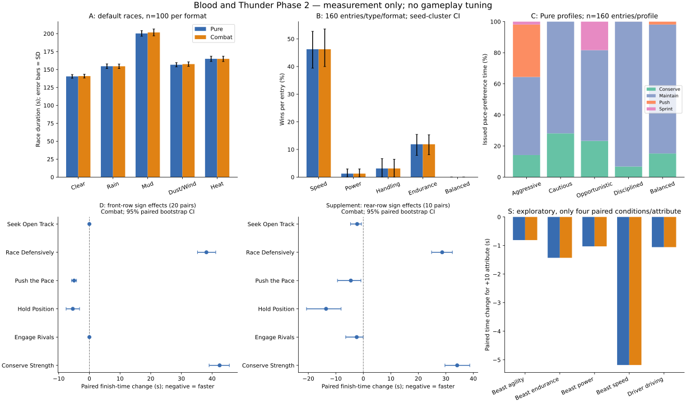

# Phase 2 simulation analysis

**Completed 1130 races: 560 Pure and 570 Combat.** The frozen primary workload is 500 per format; a separately declared, data-informed rear-row sign follow-up adds 60 Pure/70 Combat. All 1130 ended, all 9040 entries finished, and there were no integrity errors, stalls, bounded terminations, tool failures, DNFs or DNS outcomes. No gameplay coefficient, AI weight, formula or browser-runtime source changed.

Primary coverage: 245 configuration IDs, 968 unique seeded configurations, and 32 deliberate repeat control executions with identical checksums/events. The repeats are reproducibility checks, not independent samples. There are 104 distinct numerical seeds across the combined design, reused for matched conditions.

[Methodology](PHASE2_EVALUATION_PLAN.md) · [Baseline](PHASE2_BASELINE_MANIFEST.md) · [Supplement plan](SUPPLEMENT_REAR_ROW_PLAN.md) · [Recommendations](PHASE2_FINDINGS_AND_RECOMMENDATIONS.md) · [Instrumentation](PHASE2_TEST_AND_INSTRUMENTATION_REPORT.md)

## Workload and inference

| Panel | Pure races | Combat races | Controls |
| --- | --- | --- | --- |
| A: defaults | 100 | 100 | 20 seeds × five weather presets |
| B: archetypes | 100 | 100 | 20 rotations; equal beast budgets and grid exposure |
| C: personalities | 100 | 100 | Identical components; equal tendency sums |
| S: sensitivity | 40 | 40 | Five attributes; four matched control/+10 conditions each |
| D: primary signs | 140 | 140 | 20 control blocks; Pure also includes lifecycle workflows |
| E: surfaces | 20 | 20 | Ten matched neutral/composite pairs |
| Rear-row supplement | 60 | 70 | Ten control blocks; player RU5 |
| Total | 560 | 570 | Primary and supplemental panels remain separate |

Confidence intervals below are empirical 95% seed-cluster bootstrap intervals, conditional on this selected workload. Dispersion/percentiles describe observed cases, not independent sampling units. Fixed weather composition is retained in cluster resampling, so a narrow mean interval can coexist with a large across-weather SD. Nonfinish times are null; none occur here. Sensitivity has only four pairs and is explicitly exploratory. Multiple comparisons are not corrected into confirmatory significance claims.

[PNG figure](figures/phase2-summary.png) and [full statistical JSON](data/analysis.json) support inspection/reanalysis.

## A — baseline behavior

| Metric | Pure mean [95% CI] | Pure median / SD / p10–p90 | Combat mean [95% CI] | Combat median / SD / p10–p90 |
| --- | --- | --- | --- | --- |
| duration | 163.36 [162.63, 164.14] | 157.13 / 20.43 / 141.70–201.74 | 163.87 [163.01, 164.59] | 158.40 / 20.84 / 142.14–202.34 |
| winnerGap | 2.71 [2.36, 3.13] | 1.70 / 2.65 / 0.40–5.95 | 3.60 [2.93, 4.29] | 2.64 / 3.24 / 0.52–8.99 |
| overtakes | 51.77 [50.76, 52.87] | 51.00 / 9.55 / 40.00–65.10 | 50.38 [49.42, 51.32] | 49.00 / 9.18 / 40.00–63.10 |
| damage | 9.25 [7.76, 10.78] | 4.47 / 10.57 / 0.27–27.82 | 18.23 [15.63, 20.78] | 16.82 / 11.96 / 3.33–33.59 |
| fatigueAtFinish | 17.02 [16.97, 17.06] | 16.19 / 2.72 / 13.31–20.46 | 17.13 [17.07, 17.19] | 16.34 / 2.68 / 13.54–20.57 |

Duration includes post-finish clearance; official times and gaps retain full precision. Damage is summed component-condition loss, not calibrated injury severity. There were 41/41 incidents across the respective 100-race baseline panels. Exact complete finish order/times and ties are exported per race. No natural official ties were observed across either primary panel; separate retained regression tests exercise ties.

Baseline lane attempts/successes were 3772/3772 Pure and 3654/3653 Combat. Sampled mean competitive speed averaged 12.14 / 12.14 m/s per entry; mean observed maxima were 15.91 / 15.89 m/s. These endpoint/corner observations do not establish exact continuous peak or path-integrated speed.

| Issued pace preference | Pure mean time share | Combat mean time share |
| --- | --- | --- |
| Conserve | 21.2% | 21.0% |
| Maintain | 68.2% | 68.5% |
| Push | 9.8% | 9.8% |
| Sprint | 0.8% | 0.8% |

Forward-blocked time averaged 0.287 / 0.274 seconds per entry. Repeated occupancy checks total 4184/3999; these are not automatically repeated impossible steering decisions. The outlier C-Combat-0-17-mixed-personalities / RU5 has 98 rechecks over 4.94 blocked seconds, yet all four lateral attempts succeeded and it finished. Rapid lane reversals are at most four per RU in the primary data. Passing/returning can legitimately reverse direction, so counts alone do not prove an AI loop. Default races average about 50 overtakes, contradicting a blanket persistent-procession diagnosis.

## B — RU archetype effectiveness

Each type receives 300 points per beast; other components and personality are equal. Each has 160 entry observations per format, clustered over 20 seeds, with equal grid-slot exposure. In this panel Pure and Combat physical results are identical because neutral personalities select no offensive actions.

| Archetype | Race wins / 100 | Entry win rate [95% CI] | Mean finished position | Mean finish fatigue | Mean damage taken |
| --- | --- | --- | --- | --- | --- |
| speed | 74 | 46.3% 39.4%–52.7% | 2.00 | 19.40 | 0.72 |
| power | 2 | 1.3% 0.0%–2.9% | 5.74 | 19.99 | 0.94 |
| handling | 5 | 3.1% 0.0%–6.7% | 5.61 | 19.48 | 0.22 |
| endurance | 19 | 11.9% 7.9%–15.4% | 3.99 | 13.62 | 0.44 |
| balanced | 0 | 0.0% 0.0%–0.0% | 5.15 | 18.70 | 0.36 |

Speed wins 74/100 races; Endurance wins 19, Handling 5, Power 2 and Balanced 0. This is strong conditional leverage under flat beast-point budgets, not proof of a universally best build or an approved cost model. Endurance wins 9/20 races in both Heavy Rain/Mud and Extreme Heat, versus Speed's 11/20 in each; the weather interaction provides a real competing niche. Power and Handling remain weak in this reference geometry/field. All chariots/equipment/team sizes are held fixed, so this is not a study of heavy chariots, weapon equipment or mixed team sizes.

| Weather | Speed race wins /20 | Endurance race wins /20 | Handling race wins /20 | Power race wins /20 |
| --- | --- | --- | --- | --- |
| Clear | 15 | 0 | 3 | 2 |
| Rain | 18 | 0 | 2 | 0 |
| Heavy Rain/Mud | 11 | 9 | 0 | 0 |
| Dust/Wind | 19 | 1 | 0 | 0 |
| Extreme Heat | 11 | 9 | 0 | 0 |

### Individual sensitivity

+10 is applied to both beasts for beast attributes (+20 raw points), or to one driver's Driving (+10 raw points). These are marginal ceteris-paribus tests, not equal-cost cross-component purchases. The player is the same front-row RU1 in all pairs, creating a position ceiling; official time is the informative endpoint. Pure and Combat numerical effects are identical in this balanced field.

| Attribute | Pairs / format | Mean time change (s) | 95% paired CI | Mean position change |
| --- | --- | --- | --- | --- |
| beasts.agility | 4 | -0.81 | [-1.00, -0.62] | 0.00 |
| beasts.endurance | 4 | -1.43 | [-2.41, -0.46] | 0.00 |
| beasts.power | 4 | -1.03 | [-1.54, -0.62] | 0.00 |
| beasts.speed | 4 | -5.18 | [-6.55, -3.97] | 0.00 |
| driver.driving | 4 | -1.06 | [-1.32, -0.79] | 0.00 |

All five increments improve mean official time in these four selected conditions; none is shown inert or unexpectedly negative. Speed's -5.18 s effect exceeds the other tested beast increments. This small panel does not establish precise relative pricing or global monotonicity.

## C — personality and behavior

Profiles share driver skills/components/equipment and a 300-point tendency budget. Names denote six-dimensional profiles, not isolated single-tendency treatments. In particular the disciplined profile's wins cannot be attributed to Tactical Discipline alone when no signs are issued.

| Profile | Pure win rate / entry | Combat win rate / entry | Conserve share (Pure) | Push share | Sprint share | Combat attacks / entry | Combat defensive selections / entry |
| --- | --- | --- | --- | --- | --- | --- | --- |
| aggressive | 13.1% | 15.6% | 14.2% | 33.7% | 1.9% | 5.50 | 0.00 |
| cautious | 0.6% | 0.6% | 28.1% | 0.0% | 0.0% | 0.00 | 42.89 |
| opportunistic | 8.8% | 10.6% | 23.3% | 0.0% | 18.4% | 2.41 | 0.00 |
| disciplined | 28.1% | 26.9% | 6.8% | 0.0% | 0.0% | 0.00 | 0.00 |
| balanced | 11.9% | 8.8% | 15.2% | 1.9% | 0.0% | 0.00 | 0.00 |

Aggressive profiles favor Push; opportunistic profiles uniquely sustain substantial Sprint time; cautious profiles conserve more and select defensive combat. Disciplined profiles predominantly Maintain and win 45/100 Pure and 43/100 Combat races. This is meaningful behavioral differentiation, not a guarantee that all profiles are competitively balanced. No casualties/control loss were observed to measure a safety payoff for cautious behavior.

## D — Strategy Signs

### Primary front-row panel

All 20 no-sign player RU1 controls per format finish first (1–1). Rank cannot improve from that ceiling. Each single-sign arm uses one queue/activation. Fatigue changes below are percentage-point changes in individual-beast fatigue averaged for that RU.

| Sign | Format / pairs | Full compliance among applicable | Inapplicable decisions | Δ time (s) [95% CI] | Δ fatigue | Δ place |
| --- | --- | --- | --- | --- | --- | --- |
| Conserve Strength | Pure; same means in Combat / 20 | 97.0% | 0.0% | 42.47 [39.00, 45.64] | -18.58 | 7.00 |
| Hold Position | Pure; same means in Combat / 20 | 97.2% | 0.0% | -5.40 [-7.60, -3.31] | 3.30 | 0.00 |
| Push the Pace | Pure; same means in Combat / 20 | 84.5% | 0.0% | -4.98 [-5.80, -4.15] | 13.36 | 0.00 |
| Race Defensively | Pure; same means in Combat / 20 | 97.2% | 0.0% | 38.16 [35.30, 41.15] | -18.58 | 7.00 |
| Seek Open Track | Pure; same means in Combat / 20 | 0.0% | 12.0% | 0.00 [0.00, 0.00] | 0.00 | 0.00 |
| Engage Rivals | Combat / 20 | 92.4% | 93.3% | 0.00 [0.00, 0.00] | 0.00 | 0.00 |

Conserve/Defensive instructions are followed but sacrifice time/position for fatigue reduction. Seek Open Track produces no changed race time, fatigue or place here; it is mostly overridden rather than followed. Engage is inapplicable for 93.3% of decisions, but where applicable is usually followed. It adds 17.05 attack contests and 16.95 condition points of damage dealt to other RUs without improving an already-first finishing position. That is context-limited opportunity, not proof the sign lacks a mechanical effect.

The Pure replacement/cancel lifecycle variants each have ten runs, consume all three permitted uses, activate the replacement at the next common-line crossing, and lower Active after lap one. Their mean place/time changes are 0.60 places / 4.84 s and 0.50 places / 4.64 s. Canceled/replaced uses are not refunded. No independent sign-expiration event exists; outstanding signs at termination are recorded, and competitive lifetime ends at finish/retirement.

### Separately declared rear-row follow-up

Player RU5 controls average position 6.60, range 5–8. Each sign has ten matched controls. This data-informed follow-up is not pooled into the primary estimates.

| Sign | Format / pairs | Full compliance | Inapplicable | Δ place [95% CI] | Δ time (s) [95% CI] | Δ fatigue |
| --- | --- | --- | --- | --- | --- | --- |
| Conserve Strength | Pure; same means in Combat / 10 | 97.2% | 0.0% | 1.40 [0.80, 2.10] | 34.13 [29.50, 38.33] | -18.77 |
| Hold Position | Pure; same means in Combat / 10 | 91.8% | 0.0% | -4.30 [-5.40, -3.20] | -13.55 [-20.51, -7.95] | 3.57 |
| Push the Pace | Pure; same means in Combat / 10 | 61.0% | 0.0% | -1.80 [-2.70, -0.80] | -4.54 [-9.15, -0.59] | 12.95 |
| Race Defensively | Pure; same means in Combat / 10 | 96.9% | 0.0% | 1.40 [0.70, 2.10] | 28.68 [24.56, 32.10] | -18.77 |
| Seek Open Track | Pure; same means in Combat / 10 | 3.8% | 49.5% | -0.40 [-0.70, -0.10] | -2.24 [-4.82, -0.65] | 0.02 |
| Engage Rivals | Combat / 10 | 81.6% | 85.4% | -1.20 [-1.80, -0.70] | -2.40 [-6.40, -0.05] | -0.22 |

Hold Position beats Push in these rear-row cases by a paired -2.50 places and -9.01 s, with -9.39 less fatigue. Its Maintain bias and fewer lane changes are plausible mechanisms, not a hidden physical-stat bonus. This is an owner-review balance/semantics candidate, not authorization to weaken Hold or strengthen Push.

Seek Open Track is rarely classified fully followed, but changes lane behavior and yields a small mean rear-row benefit. Rarely followed does not necessarily mean no effect. Rear-row Engage adds 39.10 attacks, 50.03 inflicted condition points, and improves mean place by -1.20. It remains often inapplicable; opportunity should be considered before a blanket strength adjustment.

## E — combat and environment

Across the primary 500 Combat races: 2427 valid attack contests, 358 successful attacks, 2381 defensive reactions and 2063 successful reactive defenses. With the supplement there are 2818 valid contests, **zero rams**, and zero offensive actions in Pure. Zero rams is a specific coverage/AI-selection concern discussed in the recommendations; it does not show the physical ram resolver is absent.

Matched A Combat-minus-Pure differences (100 weather/seed pairs, 20 seed clusters):

| Metric | Mean paired change | 95% seed-cluster CI | SD of paired differences |
| --- | --- | --- | --- |
| duration | 0.51 | [-0.10, 1.28] | 3.18 |
| damage | 8.98 | [6.04, 12.19] | 10.40 |
| attacks | 8.21 | [7.65, 8.83] | 2.87 |
| overtakes | -1.39 | [-2.94, -0.17] | 6.42 |
| dnfs | 0.00 | [0.00, 0.00] | 0.00 |
| fatigue | 0.11 | [0.06, 0.17] | 0.28 |
| collisions | -0.49 | [-0.94, -0.09] | 1.79 |

Combat increases damage but has a small, uncertain average race-duration effect in this field; the duration interval spans zero. Damage/attack associations do not prove a desired injury rate. All 1130 races have zero DNFs/wrecks/control-loss emissions. The A panels each contain only 20 independent seed clusters; zero seeds with a retirement across five weather contexts has a Wilson upper bound of 16.1%. That bound describes the selected five-context seed event, not per-entry retirement probability. Do not apply an IID rule-of-three to 9,040 correlated entries or claim lethality is universally zero. Secondary wreck interactions cannot be evaluated statistically from this workload and remain covered only by retained deterministic regressions.

| Weather | Pure duration mean (s) | Combat duration mean (s) | Pure fatigue at finish | Combat fatigue at finish |
| --- | --- | --- | --- | --- |
| Clear | 140.40 | 140.81 | 13.36 | 13.51 |
| Rain | 154.58 | 154.51 | 15.30 | 15.51 |
| Heavy Rain/Mud | 200.27 | 201.67 | 19.71 | 19.79 |
| Dust/Wind | 156.65 | 157.50 | 16.23 | 16.29 |
| Extreme Heat | 164.89 | 164.87 | 20.48 | 20.56 |

Heavy Rain/Mud increases duration materially; Heat raises fatigue despite less duration than Mud. Endurance's relative win share rises in both, consistent with the model. In E, degraded composite surfaces change mean duration by 38.99 s [36.37, 41.84] and mean finish fatigue by 3.79 [2.96, 4.64] across ten matched pairs. The same mean effects occur in Combat's neutral-personality field. These are effects of the declared composite, not separate causal estimates for grip, roughness, rolling resistance or hazard weighting.

## Interpretation and limitations

- Observations: all completed, explicit overtake/action/damage counts, exact outcomes and broad behavioral differences.
- Controlled conditional effects: matched sign, format, weather, surface and +10 sensitivity differences under the saved inputs; not universal design guarantees.
- Associations: a composite named personality or flat-budget build's win rate does not isolate a single skill/tendency or establish economic pricing.
- Hypotheses: Hold's Maintain bias, ram utility dominance and Speed's long-run leverage need owner-reviewed follow-up; no coefficient was changed here.
- Coverage: one reference oval/three laps, two-beast healthy teams, fixed chariots/equipment, five weather presets, one surface composite, four sensitivity conditions and ten rear-row pairs. No exhaustive factorial, wounded entrants, heavy ram specialist, long-run economy, persistent fatigue economy or final balance target is tested.
- Measurement limits: maximum/average speed and lane occupancy are sampled; tactical/strategic labels are timing proxies; control counts are structured emissions; complete no-damage impact energy is unavailable. Exact issued pace durations and finish fatigue use authoritative event times/snapshots. Metrics and definitions are in the methodology/data dictionary.

**No confirmed implementation defect requiring a corrective pass was established by this study.** That is not proof of universal correctness. Recommendations are proposals only; no tuning or publication follows from these results.
